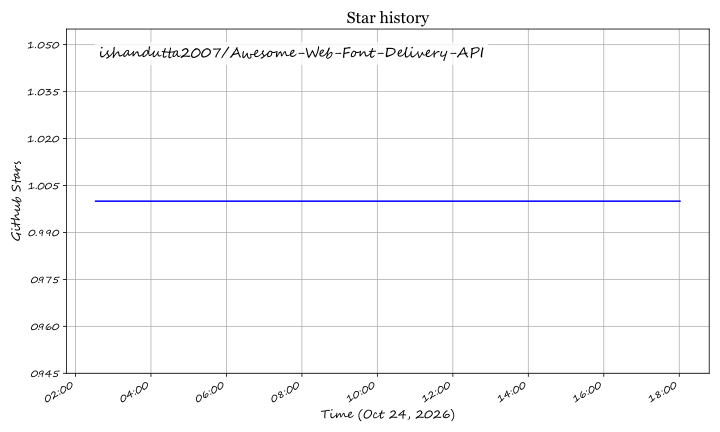

# Awesome-Web-Font-Delivery-API

## Top Web Font Delivery API Ecosystem

**Curated List of SaaS Products & Open-Source GitHub Projects**  
*Focused on Self-Hosted Font Serving, GDPR-Compliant Subsetting & Build-Time Embedding*  
**Last updated: March 2026**

This repository tracks notable **SaaS platforms** and **open-source projects** for **Web Font Delivery APIs**. These tools serve font files to websites — handling the CSS generation, subsetting, and caching that makes typography fast and privacy-compliant — with a spectrum running from commercial font foundries to open-source self-hosted services that eliminate third-party tracking.

**Examples** include Fontless, Google Webfonts Helper, Fontsource, and Fontsource Downloader (the category leaders).

**Open-source emphasis**: This section is heavily expanded with every major active project for self-hosting, build-time font embedding, and GDPR-compliant delivery — ideal for developers who want Google Fonts convenience without Google tracking their users.

Contributions welcome! Open a PR to add/update entries. Keep descriptions factual and link to official sites.

## Table of Contents
- [SaaS/Hosted Platforms](#saas-hosted-platforms)
- [Open-Source GitHub Projects](#open-source-github-projects)
- [How to Contribute](#how-to-contribute)
- [Star History](#star-history)
- [Disclaimer](#disclaimer)

## SaaS/Hosted Platforms

The table below outlines leading enterprise hosted and cloud-native SaaS web font delivery platforms, comparing specific starting tier pricing, free tier/trial limits, and architectural delivery models.

| Platform | Company & Scale (Valuation / Revenue) | Starting Tier Price | Free Tier Limit / Free Trial Limits | Key Capabilities & Architecture Focus |
| :--- | :--- | :--- | :--- | :--- |
| **[Google Fonts](https://fonts.google.com/)** | **Alphabet Inc. (Google)** 📊 Valuation: ~$2.10T Market Cap 💰 FY24 Revenue: $350B | **$0.00** (100% Free & Open Source under SIL OFL / Apache 2.0) | **Free forever with unlimited pageviews and unlimited font requests** across 1,500+ font families; Developer Metadata API includes 10,000 queries/day per project free quota | Global Anycast multi-CDN serving WOFF2/WOFF formats with automated browser detection, dynamic CSS2 `@font-face` generation, variable font axis control (`wght`, `ital`), and cross-site caching. |
| **[Adobe Fonts](https://fonts.adobe.com/)** | **Adobe Inc.** 📊 Valuation: ~$215B Market Cap 💰 FY24 Revenue: $21.4B | **$9.99 / month** (via Adobe Express Premium or Creative Cloud single-app plan; $59.99/mo for CC All Apps) | **Free-forever Basic Library** (~1,000+ fonts) included with any free Adobe account; **7-day free trial** of Creative Cloud unlocking full library (30,000+ fonts); **unlimited pageviews** on all web projects with no traffic overage fees | Managed web font hosting via `use.typekit.net` CDN with project ID embedding, desktop font syncing, and direct integration with Figma, InDesign, Photoshop, and Creative Cloud Enterprise. |
| **[Monotype Fonts](https://www.monotypefonts.com/)** | **Monotype Imaging Inc.** 📊 Valuation: ~$825M (HGGC Private Equity) 💰 Annual Revenue: ~$200M+ | **$199 / user / year** (~$16.58 / month) for Monotype Connect entry tier; standalone web font licenses start at **$20.00 / style** for 10,000 pageviews/month | **30-day free trial** with access to explore 150,000+ commercial typefaces (strictly limited to prototyping, staging, and mockups; zero production deployment rights permitted during trial) | Enterprise typography governance platform with cloud-hosted font delivery, smart desktop syncing plugins, digital ad embedding licenses, and centralized foundry asset management. |
| **[Bunny Fonts](https://fonts.bunny.net/)** | **BunnyWay d.o.o. (bunny.net)** 📊 Valuation: ~$50M Bootstrapped 💰 Global Tier-1 CDN Provider | **$0.00** (100% Free & Open Source) | **Free forever with unlimited pageviews and unlimited bandwidth**; 100% GDPR-compliant with zero IP tracking, no logging, and zero account registration or API keys required | Drop-in 1:1 privacy-first replacement for Google Fonts API via Bunny CDN's 120+ global PoP network, automatic modern format conversion (WOFF2/WOFF), and zero third-party tracking. |
| **[Cloud.typography](https://www.typography.com/cloud/)** | **Hoefler&Co. (Monotype)** 📊 Legendary Type Foundry 💰 Acquired by Monotype in 2021 | **$199.00 / year** (~$16.58 / month) base subscription tier covering up to **250,000 pageviews / month** | **1 GB free development bandwidth** for local testing, prototyping, and staging servers before production launch; no permanent free-forever production tier (requires $199/yr license) | Specialized screen-optimized web font delivery engine with server-side font subsetting, cross-browser WOFF/EOT delivery, multi-domain assignment, and exclusive access to Gotham, Mercury, and Archer. |
| **[Type Network](https://www.typenetwork.com/)** | **Type Network LLC** 📊 Independent Type Foundry Alliance 💰 Established 2016 | **$15.00 / style / year** (entry hosted web font license for up to 10,000 pageviews/month; publication bundles from $2,000/year) | **30-day free trial** of hosted web font service with live test domain embed code for evaluating typeface rendering and performance prior to commercial licensing | Curated foundry alliance platform (Font Bureau, Cabarga Type, Carter & Cone) providing CDN-hosted web font delivery via direct code snippet integration without local font asset downloads. |

## Open-Source GitHub Projects

- **Fontsource** — **The NPM package approach to self-hosted fonts.** MIT licensed, **45+ versions** with active maintenance as of March 2026. **Packages open-source fonts as installable npm modules** — `npm install @fontsource/open-sans` — so fonts are bundled into your build rather than fetched from a third-party CDN. **Self-hosting improves performance** by eliminating extra DNS resolution and TCP connection establishment required by CDN like Google Fonts, and **fonts remain version locked** — Google often pushes updates without notice, which can interfere with production projects. **Privacy**: Google tracks font usage; self-hosting is the alternative. **Supports fonts outside the Google Font ecosystem**, including variable fonts like `@fontsource-variable/roboto-flex`. **Best for JavaScript/TypeScript projects** where build-time font embedding fits the bundler workflow.

- **Fontless** — **The Vercel-deployable Google Fonts privacy replacement.** MIT licensed, built to provide the same simplicity as Google Fonts but for self-hosted fonts. **Drop-in API compatibility**: replace `fonts.googleapis.com` with your Fontless instance hostname, and existing `<link>` tags work unchanged — full support for the Google Fonts CSS2 API. **No tracking, no cookies, no analytics** — just fonts served from your own domain. **Web-based setup**: select fonts in a browser UI, then deploy to Vercel or download the generated service. **Works by downloading fonts from Google Fonts at build-time** and placing them in a `/fonts` directory, with a serverless function implementing the CSS2 API. **Best for teams wanting Google Fonts convenience without Google tracking**, especially those already on Vercel.

- **Google Webfonts Helper** — **The self-hosted font downloader with CSS snippets.** MIT licensed, available as a public instance at `gwfh.mranftl.com` or self-hosted via Docker. **Downloads font files in eot, ttf, svg, woff, and woff2 formats**, with customized CSS `@font-face` snippets. **Requires a Google Fonts API key** for self-hosting (`GOOGLE_FONTS_API_KEY`). **The classic solution** for developers who want to download Google Fonts once and serve them locally. **Best for one-time font extraction** where you want static files and CSS rather than a running service.

- **Fontsource Downloader** — **The library for downloading and caching Fontsource fonts programmatically.** MIT licensed. **Downloads a batch of fonts per family based on a given query**, with **asynchronous downloads with true parallelism**. **Generates CSS `@font-face` rules** — both CDN URLs and self-hosting relative path URLs are supported, and self-hosted font files can be copied from cache to a destination directory. **Caching enabled** (with customizable cache root dir) for both metadata and font files. **Rust consumers get to choose their desired TLS backend**. **Best for teams wanting programmatic control** over Fontsource font downloads with caching, rather than manual npm installation.

- **Web Fonts Repository (finesse)** — **The self-hosted webfont hosting service inspired by Google Fonts.** PHP-based, runs on your own server, stores and distributes webfont files, and **generates CSS on-the-go for embedding fonts on web pages**. **Usage syntax mirrors Google Fonts**: `<link rel="stylesheet" href="http://your-server/css?family=Open+Sans:400,400i,700|Roboto:300,400" />`. **Configure fonts via a PHP settings file** with glob patterns mapping weights and styles to files in the `public/fonts` directory. **Requires**: PHP ≥ 7.0, Composer, and CORS headers on font files (`Access-Control-Allow-Origin: *`). **Best for PHP-based stacks** wanting a self-hosted Google Fonts clone with familiar URL syntax.

### Additional Strong Open-Source Options

- **Coolify Fonts** — **Privacy-friendly drop-in replacement for Google Fonts.** Apache-2.0 licensed, **602 GitHub stars**, actively maintained through January 2026. **A CDN alternative** that serves Google Fonts without the tracking. **Best for teams already in the Coolify ecosystem** or wanting a simple privacy-focused Google Fonts CDN replacement.

- **MkDocs Fontkit** — **Static analysis font kit builder for MkDocs.** MIT licensed. **Self-hosts fonts from Adobe Fonts (Typekit) and Google Fonts locally** without relying on client-side JS or external CDNs. **Static analysis for Typekit** reverses the dynamic loading logic to generate stable WOFF2 URLs and CSS using Bloom filters and hash generation — no Headless Chrome required. **Smart CJK font splitting** integrates `cn-font-split` to chunk large Chinese/Japanese/Korean fonts for faster initial load. **Best for MkDocs documentation sites** needing self-hosted fonts with CJK support.

- **Bengal Fonts System** — **Built-in font management for the Bengal static site generator.** MIT licensed. **Automatically downloads and hosts Google Fonts locally** — zero configuration, just specify fonts in `bengal.toml`. **No external requests to Google Fonts CDN at runtime**, faster page loads, GDPR/privacy compliance, offline builds, and cache control. **Downloads WOFF2 and TTF formats**, generates `@font-face` CSS with CSS custom properties. **Best for Bengal users** wanting automatic self-hosted font handling without manual setup.

- **fontello-server** — **Self-hosted icon font server.** MIT licensed, persists fontello icon fonts in LevelDB and serves them with hashed links. **Best for icon font delivery** rather than text typefaces.

**Frameworks for building custom systems**: Combine **Fontless** for a Vercel-deployed Google Fonts replacement with drop-in API compatibility, **Fontsource** for NPM-based font embedding in JavaScript builds with version locking, **Google Webfonts Helper** for one-time static font extraction with CSS snippets, and **Fontsource Downloader** for programmatic font downloading with caching — to build a web font delivery stack tailored to your privacy requirements, build toolchain, and deployment model.

## How to Contribute

1. Fork the repo.
2. Add/edit entries in `README.md` (follow existing format).
3. Include: name, link, 1–2 sentence description, and whether it's SaaS or open-source.
4. Submit PR with a short explanation.

Star the repo if you find it useful!

## Star History

<a href="https://star-history.com/#ishandutta2007/Awesome-Web-Font-Delivery-API&Timeline" align="center">
  <picture>
    <source media="(prefers-color-scheme: dark)" srcset="assets/ishandutta2007_Awesome-Web-Font-Delivery-API_growth.svg">
    
  </picture>
</a>

## Disclaimer

- This is a **community-curated** list — not exhaustive and not an endorsement.
- Web font delivery APIs differ significantly in privacy model, build integration, and hosting requirements. **Google Fonts is free and ubiquitous** but logs IP addresses and user agents for every request, creating GDPR compliance issues. **Fontless provides drop-in API compatibility** — replace the hostname and existing `<link>` tags work unchanged — while eliminating third-party tracking. **Fontsource moves fonts into your build**, improving performance by eliminating extra DNS resolution and TCP connection establishment, and keeps fonts version locked so Google's unannounced updates can't break production. **Google Webfonts Helper requires a Google Fonts API key** for self-hosting. **Self-hosting shifts responsibility to you** — font licensing, cache headers, and CORS configuration become your operations.
- Self-hosted open-source solutions require proper CORS headers for cross-origin font files, cache-control configuration for immutable asset hashing, and awareness that WOFF2 is the only format modern browsers need.

---

**Made for web developers serving typography that's fast, private, and properly licensed.**  
Let's make web font delivery more open, GDPR-compliant, and build-integrated.
