<div align="center">

  

  # 🔤 Awesome Web Font Delivery API

  <p align="center">
    <strong>A curated directory of top-tier Web Font Delivery APIs, Edge CDNs, Self-Hosted Servers, Subsetting Engines &amp; GDPR-Compliant Typography Frameworks.</strong>
  </p>

  <p align="center">
    <a href="https://github.com/ishandutta2007/Awesome-Awesome-Awesome"></a><a href="https://discord.gg/jc4xtF58Ve"></a>
    <a href="https://github.com/ishandutta2007/Awesome-Web-Font-Delivery-API/stargazers"></a>
    <a href="https://github.com/ishandutta2007/Awesome-Web-Font-Delivery-API/network/members"></a>
    <a href="https://github.com/ishandutta2007/Awesome-Web-Font-Delivery-API/blob/main/LICENSE"></a>
    <a href="https://github.com/ishandutta2007/Awesome-Web-Font-Delivery-API/pulls"></a>
    <a href="https://github.com/ishandutta2007"></a>
  </p>

</div>

---

## 📖 Overview & Architecture Landscape

In modern web performance and frontend engineering, typography delivery directly impacts **Core Web Vitals** (specifically **Largest Contentful Paint (LCP)** and **Cumulative Layout Shift (CLS)**). **Web Font Delivery APIs** streamline the complex lifecycle of serving web fonts: dynamic CSS `@font-face` generation, user-agent sniffing to serve compressed **WOFF2** binaries, unicode-range subsetting, variable font axis negotiation, and low-latency edge caching.

However, default third-party hosted services like Google Fonts log user IP addresses and client user-agents during stylesheet and font-binary handshakes. Under European regulations (GDPR), unconsented IP exfiltration to third-party endpoints has triggered legal compliance risks. Consequently, modern web architectures are rapidly bifurcating into:
1. **Managed SaaS / Edge Font CDNs** providing high-scale dynamic generation with global Anycast caching.
2. **Self-Hosted & Build-Time Bundled Architectures** (such as NPM packaging via Fontsource, Vercel drop-in proxies via Fontless, and build-time static subsetters via Subfont and Glyphhanger) that eradicate cross-origin HTTP round-trips, isolate data governance, and guarantee zero-tracking privacy compliance.

---

## 📑 Table of Contents

- [🌐 Sector Overview & Market Dynamics](#-sector-overview--market-dynamics)
- [☁️ SaaS & Hosted Font Delivery Platforms](#️-saas--hosted-font-delivery-platforms)
- [🔓 Open-Source GitHub Projects (Ranked by Stars)](#-open-source-github-projects-ranked-by-stars)
- [📊 Architectural Comparison Matrix](#-architectural-comparison-matrix)
- [🤝 How to Contribute](#-how-to-contribute)
- [📈 Star History](#-star-history)
- [💖 Support & Sponsorship](#-support--sponsorship)
- [⚖️ Disclaimer](#️-disclaimer)

---

## 🌐 Sector Overview & Market Dynamics

The global **Digital Font & Web Font Delivery API market** was valued at approximately **$1.2 Billion in 2024** and is projected to surpass **$1.8 Billion by 2030** (with adjacent enterprise font management and web delivery segments accelerating toward **$3.5 Billion** at a ~7.2% CAGR), propelled by responsive web typography, mobile-first UX rendering, and variable font adoption.

Market concentration follows a two-tier paradigm:
1. **Font Delivery & Edge Serving Layer (Highly Concentrated / Winner-Take-All)**: Public cloud infrastructure and hyper-scale CDNs dominate runtime delivery — **Google Fonts** commands a near-ubiquitous position serving web fonts to over 75% of global top-million websites alongside **Adobe Fonts**, creating substantial vendor lock-in around third-party CSS APIs.
2. **Foundry Licensing & Self-Hosted Ecosystem (Moderately Fragmented)**: The commercial typeface licensing tier is contested among major foundries (**Monotype**, **Type Network**, independent type designers), while the rapid emergence of **GDPR-compliant self-hosted engines** (Fontsource, Fontless, Coolify Fonts) and dynamic CJK subsetters (cn-font-split) provides an increasingly popular open-source privacy counterweight.

---

## ☁️ SaaS & Hosted Font Delivery Platforms

The table below outlines leading enterprise hosted and cloud-native SaaS web font delivery platforms, comparing company scale, specific starting tier pricing, free tier/trial limits, and architectural delivery models. Rows are sorted descending by company scale (valuation / market capitalization).

| Platform | Company Scale (Valuation / Revenue) | Starting Tier Price | Free Tier Limit / Free Trial Limits | Key Capabilities & Architecture Focus |
| :--- | :--- | :--- | :--- | :--- |
| **[Google Fonts](https://fonts.google.com/)** | **Alphabet Inc. (Google)**<br>📊 Valuation: ~$2.10T Market Cap<br>💰 FY24 Revenue: $350B | **$0.00** (100% Free & Open Source under SIL OFL / Apache 2.0) | **Free forever with unlimited pageviews and unlimited font requests** across 1,500+ font families; Developer Metadata API includes 10,000 queries/day per project free quota | Global Anycast multi-CDN serving WOFF2/WOFF formats with automated browser detection, dynamic CSS2 `@font-face` generation, variable font axis control (`wght`, `ital`), and cross-site caching. |
| **[Adobe Fonts](https://fonts.adobe.com/)** | **Adobe Inc.**<br>📊 Valuation: ~$215B Market Cap<br>💰 FY24 Revenue: $21.4B | **$9.99 / month** (via Adobe Express Premium or Creative Cloud single-app plan; $59.99/mo for CC All Apps) | **Free-forever Basic Library** (~1,000+ fonts) included with any free Adobe account; **7-day free trial** of Creative Cloud unlocking full library (30,000+ fonts); **unlimited pageviews** on all web projects with no traffic overage fees | Managed web font hosting via `use.typekit.net` CDN with project ID embedding, desktop font syncing, and direct integration with Figma, InDesign, Photoshop, and Creative Cloud Enterprise. |
| **[Monotype Fonts](https://www.monotypefonts.com/)** | **Monotype Imaging Inc.**<br>📊 Valuation: ~$825M (HGGC Private Equity)<br>💰 Annual Revenue: ~$200M+ | **$199 / user / year** (~$16.58 / month) for Monotype Connect entry tier; standalone web font licenses start at **$20.00 / style** for 10,000 pageviews/month | **30-day free trial** with access to explore 150,000+ commercial typefaces (strictly limited to prototyping, staging, and mockups; zero production deployment rights permitted during trial) | Enterprise typography governance platform with cloud-hosted font delivery, smart desktop syncing plugins, digital ad embedding licenses, and centralized foundry asset management. |
| **[Bunny Fonts](https://fonts.bunny.net/)** | **BunnyWay d.o.o. (bunny.net)**<br>📊 Valuation: ~$50M Bootstrapped<br>💰 Global Tier-1 CDN Provider | **$0.00** (100% Free & Open Source) | **Free forever with unlimited pageviews and unlimited bandwidth**; 100% GDPR-compliant with zero IP tracking, no logging, and zero account registration or API keys required | Drop-in 1:1 privacy-first replacement for Google Fonts API via Bunny CDN's 120+ global PoP network, automatic modern format conversion (WOFF2/WOFF), and zero third-party tracking. |
| **[Cloud.typography](https://www.typography.com/cloud/)** | **Hoefler&Co. (Monotype)**<br>📊 Legendary Type Foundry<br>💰 Acquired by Monotype in 2021 (~$40M) | **$199.00 / year** (~$16.58 / month) base subscription tier covering up to **250,000 pageviews / month** | **1 GB free development bandwidth** for local testing, prototyping, and staging servers before production launch; no permanent free-forever production tier (requires $199/yr license) | Specialized screen-optimized web font delivery engine with server-side font subsetting, cross-browser WOFF/EOT delivery, multi-domain assignment, and exclusive access to Gotham, Mercury, and Archer. |
| **[Type Network](https://www.typenetwork.com/)** | **Type Network LLC**<br>📊 Independent Type Foundry Alliance<br>💰 Established 2016 (~$15M Scale) | **$15.00 / style / year** (entry hosted web font license for up to 10,000 pageviews/month; publication bundles from $2,000/year) | **30-day free trial** of hosted web font service with live test domain embed code for evaluating typeface rendering and performance prior to commercial licensing | Curated foundry alliance platform (Font Bureau, Cabarga Type, Carter & Cone) providing CDN-hosted web font delivery via direct code snippet integration without local font asset downloads. |

---

## 🔓 Open-Source GitHub Projects (Ranked by Stars)

A curated list of leading open-source projects for self-hosting web fonts, local font subsetting, CSS generation, and build-time bundling. Entries are ordered strictly descending by GitHub star count.

- **[google-webfonts-helper](https://github.com/majodev/google-webfonts-helper)** [](https://github.com/majodev/google-webfonts-helper/stargazers) — **A hassle-free way to self-host Google Fonts.** Provides a web GUI and Docker image to download Google Font files in EOT, TTF, SVG, WOFF, and WOFF2 formats along with customized `@font-face` CSS snippets. Requires a Google Fonts API key for self-hosting. Best for one-time font extraction and static site deployment.

- **[Fontsource](https://github.com/fontsource/fontsource)** [](https://github.com/fontsource/fontsource/stargazers) — **Self-host Open Source fonts in neatly bundled NPM packages.** Packages 1,500+ fonts as installable npm modules (`npm install @fontsource/open-sans`). Fonts are bundled directly into modern bundler workflows (Vite, Webpack, Next.js), eliminating third-party DNS lookups, version drift, and external tracking while supporting variable font axes.

- **[Fontmin](https://github.com/ecomfe/fontmin)** [](https://github.com/ecomfe/fontmin/stargazers) — **Seamless font minification and subsetting engine.** High-performance Node.js tool to extract character glyph subsets from TTF fonts, convert them to TTF, EOT, WOFF, and WOFF2 formats, and generate accompanying CSS `@font-face` rules. Ideal for automated CI/CD font optimization.

- **[fonttools](https://github.com/fonttools/fonttools)** [](https://github.com/fonttools/fonttools/stargazers) — **The industry-standard library to manipulate font files in Python.** Provides `pyftsubset` for aggressive font subsetting, table manipulation, hinting, and OpenType/TrueType/WOFF2 generation. Powerhouse engine behind automated web font subsetting pipelines globally.

- **[Typefaces](https://github.com/KyleAMathews/typefaces)** [](https://github.com/KyleAMathews/typefaces/stargazers) — **NPM packages for open-source typefaces.** Predecessor framework to Fontsource created by Kyle Mathews, pioneering the concept of bundling self-hosted fonts into JavaScript application dependencies.

- **[woff2](https://github.com/google/woff2)** [](https://github.com/google/woff2/stargazers) — **Google's reference WOFF 2.0 font compression and decompression library.** Implements the Brotli compression algorithm for font data, delivering up to 30% reduction in webfont size compared to WOFF 1.0.

- **[php-font-lib](https://github.com/dompdf/php-font-lib)** [](https://github.com/dompdf/php-font-lib/stargazers) — **PHP library to read, parse, export, and create subsets of font files.** Essential utility in PHP environments (such as Dompdf and dynamic font delivery services) for reading OpenType/TrueType tables and dynamically compiling font subsets.

- **[Fontkit](https://github.com/foliojs/fontkit)** [](https://github.com/foliojs/fontkit/stargazers) — **Advanced font engine for Node.js and the browser.** Supports TTF, WOFF, WOFF2, DFONT, and CFF formats with glyph shaping, bidirectional text mapping, variable font axis metrics, and ligature substitions via HarfBuzz integration.

- **[Subfont](https://github.com/Munter/subfont)** [](https://github.com/Munter/subfont/stargazers) — **Command-line tool for automated webfont optimization and preloading.** Scrapes your static HTML files, analyzes actual glyph usage, creates ultra-lean subsets, automatically self-hosts Google Fonts, injects preload headers, and writes inline `@font-face` definitions to slash First Contentful Paint.

- **[cn-font-split](https://github.com/KonghaYao/cn-font-split)** [](https://github.com/KonghaYao/cn-font-split/stargazers) — **Revolutionary multi-threaded font slicing tool for CJK and global scripts.** Solves the massive file-size problem of Chinese, Japanese, and Korean fonts (often 20MB+) by chunking fonts into hundreds of small WOFF2 subsets loaded on-demand via CSS unicode-range definitions.

- **[glyphhanger](https://github.com/filamentgroup/glyphhanger)** [](https://github.com/filamentgroup/glyphhanger/stargazers) — **Web font utility belt from Filament Group.** Inspects live web pages via Headless Chrome, determines exact unicode ranges of rendered glyphs, and runs `pyftsubset` to produce optimized WOFF2/WOFF files and CSS `@font-face` blocks.

- **[Coolify Fonts](https://github.com/coollabsio/fonts)** [](https://github.com/coollabsio/fonts/stargazers) — **Privacy-friendly drop-in replacement for Google Fonts.** Apache-2.0 licensed service engineered for the Coolify PaaS ecosystem. Mirrors the Google Fonts directory and delivers font binaries and CSS without logging client IP addresses.

- **[webify](https://github.com/ananthakumaran/webify)** [](https://github.com/ananthakumaran/webify/stargazers) — **Fast command-line webfont generator.** Converts TTF fonts into WOFF, EOT, and SVG formats with cross-browser compatibility and automated stylesheet generation.

- **[webfont](https://github.com/itgalaxy/webfont)** [](https://github.com/itgalaxy/webfont/stargazers) — **Modern generator of webfonts from SVG icons.** Compiles SVG vectors into TTF, WOFF, and WOFF2 formats with CSS and HTML preview templates, ideal for custom icon font delivery.

- **[subset-font](https://github.com/papandreou/subset-font)** [](https://github.com/papandreou/subset-font/stargazers) — **WASM-powered font subsetter using HarfBuzz.** Subsets TTF, OTF, WOFF, and WOFF2 fonts in Node.js or browser environments without requiring Python or native build toolchains.

- **[Web Fonts Repository](https://github.com/Finesse/web-fonts-repository)** [](https://github.com/Finesse/web-fonts-repository/stargazers) — **Self-hosted PHP webfont service inspired by Google Fonts.** Stores font files on your own server and generates dynamic CSS on the fly using standard URL query parameters matching Google's CSS API syntax.

- **[Fontless](https://github.com/herber/fontless)** [](https://github.com/herber/fontless/stargazers) — **Vercel-deployable Google Fonts privacy replacement.** Drop-in API compatibility with `fonts.googleapis.com` for self-hosted instances. Downloads fonts at build time and serves them through serverless functions with zero tracking and full CSS2 API support.

- **[Fontsource Downloader](https://github.com/2bndy5/fontsource-downloader)** [](https://github.com/2bndy5/fontsource-downloader/stargazers) — **Asynchronous Rust & Python library for batch downloading Fontsource fonts.** Features multi-threaded parallel downloads, caching mechanisms, and automated `@font-face` CSS rule generation.

---

## 📊 Architectural Comparison Matrix

| Project / Platform | Primary Delivery Model | Format Engine | Privacy & GDPR Status | Subsetting Support | Primary Sweet Spot |
| :--- | :--- | :--- | :--- | :--- | :--- |
| **Google Fonts** | Global Managed Anycast CDN | WOFF2, WOFF | ⚠️ Logs Client IPs / UAs | Dynamic Range Slicing | Prototyping & high-traffic sites outside strict EU privacy jurisdictions |
| **Bunny Fonts** | Privacy Edge CDN | WOFF2, WOFF | ✅ 100% GDPR Zero-Logging | Full Family Fallbacks | Zero-effort, drop-in Google Fonts replacement with zero tracking |
| **Adobe Fonts** | Enterprise Managed CDN | WOFF2, WOFF | ⚠️ Proprietary Tracking | Dynamic Web Project Kits | Teams invested in Adobe Creative Cloud needing premium foundry typefaces |
| **Fontsource** | NPM Build-Time Bundler | WOFF2, Variable | ✅ Completely Local / Private | Bundled Script Subsets | Modern SPA / SSR apps (Next.js, Vite, Nuxt) wanting version-locked npm packages |
| **Fontless** | Serverless Edge Function (Vercel) | WOFF2, TTF | ✅ Completely Local / Private | Build-Time Static Cache | Drop-in URL replacement (`fonts.my-domain.com`) for Google Fonts CSS2 API |
| **google-webfonts-helper** | Static Downloader / Docker | WOFF2, WOFF, TTF, EOT | ✅ Zero Runtime Telemetry | Manual Script Selection | Generating static `@font-face` code and downloading static font assets once |
| **Subfont** | Post-Build Static Scraper | WOFF2, WOFF | ✅ Completely Local / Private | Aggressive HTML Glyph Analysis | Blazing fast JAMstack sites aiming for 100/100 Google Lighthouse Core Web Vitals |
| **cn-font-split** | Multi-Threaded Slicing Engine | WOFF2 Multi-Chunk | ✅ Completely Local / Private | Dynamic CJK Micro-Subsets | Chinese, Japanese, and Korean websites needing to cut 20MB fonts into tiny chunks |

---

## 🤝 How to Contribute

Contributions, tool submissions, and documentation improvements are welcome!

1. **Fork the repository** to your own GitHub account.
2. **Create a descriptive feature branch**:
   ```bash
   git checkout -b feat/add-font-delivery-tool
   ```
3. **Commit your modifications** ensuring clear, factual descriptions, links to official documentation, and consistent Markdown table formatting.
4. **Push the branch** and **open a Pull Request** with an informative summary of your changes.

---

## 📈 Star History

[](https://star-history.dera.page/#ishandutta2007/Awesome-Web-Font-Delivery-API&type=date&legend=top-left)

---

## 💖 Support & Sponsorship

If you find this curated ecosystem directory valuable for your web typography architecture, frontend performance optimization, or open-source research, please consider supporting the project:

- ⭐ **Star this repository** on GitHub to amplify its reach and discoverability!
- 🍴 **Fork the repo** to save your personal reference copy.
- 📢 **Share with fellow frontend developers**, web performance engineers, and UI/UX designers.
- ☕ **Support continuous research & maintenance** by buying a coffee via the Sponsor Dashboard below:

<p align="center">
  <a href="https://github.com/sponsors/ishandutta2007">
    
  </a>
</p>

---

## ⚖️ Disclaimer

- This repository is a **community-curated index** created solely for informational, architectural, and educational purposes. Mention of specific vendors, commercial SaaS platforms, or open-source utilities does not constitute an official endorsement.
- Web font delivery APIs differ significantly in privacy model, build integration, and hosting requirements:
  - **Google Fonts** is free and ubiquitous but logs IP addresses and user agents for every request, creating GDPR compliance friction under EU rulings.
  - **Fontless** provides drop-in API compatibility — replace the hostname and existing `<link>` tags work unchanged — while eliminating third-party tracking.
  - **Fontsource** moves fonts into your build dependencies, improving performance by eliminating extra DNS resolution and keeping fonts version locked against surprise upstream foundry updates.
  - **Self-hosting** shifts operational responsibilities to your team: proper CORS headers (`Access-Control-Allow-Origin: *`), cache-control headers (`max-age=31536000, immutable`), and subset optimizations become your responsibility.
- Modern browser support for **WOFF2** is essentially 100%; legacy formats like EOT and SVG fonts are rarely necessary for modern web deployments.

---

<p align="center">
  <strong>Crafted with ❤️ for web developers, frontend performance architects, and UI/UX engineers shaping the future of fast, private, and beautifully styled web typography.</strong>
</p>
